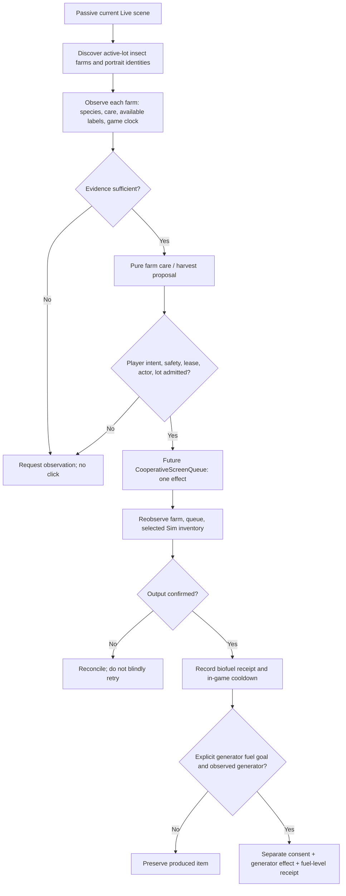

# Insect farm biofuel: discovery and implementation design

**Status: DESIGN ONLY — no automation, no local game certification.**  
**Machine design:** [BI-INSECT-FARM-BIOFUEL-DESIGN-20261110.v1.json](../plans/active/BI-INSECT-FARM-BIOFUEL-DESIGN-20261110.v1.json)  
**Existing route:** `contracts/upgrade-parts-force.v1.json#acquisition_routing.route_catalog.insect_biofuel_filled_can`  
**Existing planner/queue:** `betterinstincts/upgrade_parts_force.py`, `betterinstincts/workflow_interop.py`, `betterinstincts/screen_admit.py`.

## Objective and actual operator evidence

Design a future resource-service microsystem that can observe and care for **any number of insect farms on the active lot**, let the player choose biofuel over alternate harvest products, verify can custody, and optionally refuel an observed generator. Make it general to any household and any current portrait, and yield to the player's activity and ongoing needs. The planner must not turn into another pointer agent.

An operator-provided Sims 4 screenshot displays an insect-farm interaction pie menu with these exact visible English labels:

- **Clean Out Insect Farm** — potentially resets colony; NEVER interpret as safe routine cleanup
- **Nurture** — possible colony-care interaction
- **Collect Bio-Fuel** — candidate production collection interaction
- **Collect Cricket Flour** — alternative food harvest, potentially competing for a collection window

The screenshot shows several nearby farm-like objects, but cannot attest the *total* N on the lot, species/health, which menu items were enabled, a click completing, selected portrait inventory, or generator consumption. Do not commit/copy the screenshot itself to this repository. Its **visible UI text**, not its host file path or image pixels, is the evidence recorded here.

## Mechanics: observed, researched, and unresolved

| Mechanic | Current source evidence | How it affects design | Local proof |
| --- | --- | --- | --- |
| Feed and nurture colonies | [User's linked fuel article](https://bestgamingtips.com/sims-4-eco-lifestyle-get-fuel/); [Carl's insect farm guide](https://www.carls-sims-4-guide.com/expansionpacks/ecolifestyle/insect-farms.php) | Model hunger and health independently; suggest feed/nurture only after fresh observation | **Unproven** |
| Biofuel collection about every 24 **in-game** hours when colony is viable | Both guides | Use an approximate cooldown hint, never a wall-time timer or unconditional retry | **Unproven** |
| Harvest biofuel versus Cricket Flour/other species outputs | Operator screenshot; Carl's guide | Separate harvest product choice and assume they may compete for a farm's cycle until tested | **Unproven** |
| The guide suggests **five** bug houses | User's linked article | A throughput suggestion, **not** a placement requirement or hardcoded N | **Not a fixed rule** |
| **Clean Out** may reset the colony | Carl's guide | Destructive action; never execute automatically, never use as failed-harvest recovery | **Source warning** |
| Biofuel can run an Eco Lifestyle generator | User's link; Carl's guide; EA Forums discussions | Separate collection/inventory from generator consumption | **Unproven here** |
| Ordinary generator fueling can consume Bits/Pieces | User's linked guide; [Carl's eco-footprint guide](https://www.carls-sims-4-guide.com/expansionpacks/ecolifestyle/eco-footprint.php) | Different source/destination pathway from insect-can production | **Unproven here** |
| Biofuel eco-footprint effect | User article says fuel still worsens footprint; Carl's guide and [Sims Wiki](https://sims.fandom.com/wiki/Eco_footprint) say biofuel is the greener option | **Do not hardcode either environmental claim.** Run isolated same-build trials and measure over sufficient in-game time if this optimization matters | **Conflicting sources** |
| Eco-Upgrade Parts | [EA Civil Designer Help](https://help.ea.com/en/articles/the-sims/the-sims-4/the-sims-4-civil-designer-career/) | Fabricator uses 15 bits + 10 pieces per attempt. Do **not** route to Insect Farm or purchase picker | **Official description; local behavior unproved** |

The article does **not** prove that a particular Sim has fuel, that an insect farm is mature, or that any specific generator is ready. Similarly, do not assume collecting Cricket Flour and Biofuel can both succeed from the same farm within one cooldown just because both menu labels are visible.

## System architecture: reuse existing owners



**Sensing owner:** existing passive host listener, scene/lot map and visual observations. Do not create an unattended window harvester or allow browsing off the active lot. A farm's identity must be bound to current lot and scene revision, not a stale screen coordinate or a household-specific object name.

**Decision owner:** proposed pure `betterinstincts/insect_farm_service.py`, building on current `upgrade_parts_force` route and ontology. No direct mouse hooks. The machine contract proposed for a later implementation phase is `contracts/insect-farm-biofuel.v1.json`. These files **do not exist yet**.

**Effect owner (later, only with consent):** existing `CooperativeScreenQueue.enqueue_effect` and `screen_admit.admitted_screen_lease`. Match existing per-effect player-presence and screen-owner checks; selected Sim portrait must be revalidated before *every* care/harvest/refuel step. If a Sim must walk to the farm, treat this as a queued physical action, not instant computer ordering.

**Custody:** an insect farm, one Sim's pocket item, household Bits/Pieces resources, and a generator's fuel level are **four separate entities**. A queued interaction, changed menu, and inventory receipt are different proof levels.

## State model for each observed farm

```
UNKNOWN
  → INSPECT
     ├─ empty/dead → RECOVERY_NEEDS_OPERATOR
     ├─ hungry/unhealthy → CARE_CANDIDATE → CARE_PENDING → REINSPECT
     ├─ harvest locked → WAIT_GAME_CLOCK → REINSPECT
     └─ healthy and Collect Bio-Fuel enabled → HARVEST_CANDIDATE
          → (separately approved single action) HARVEST_PENDING
             ├─ observed Sim inventory delta → HARVEST_CONFIRMED → WAIT_GAME_CLOCK
             └─ unknown/interrupt/fail → RECONCILIATION_REQUIRED → REINSPECT
```

Default every new farm/health/readiness field to **UNKNOWN** until the local game supplies credible evidence. The farm may require Feed as well as Nurture; menu label visibility does not establish its hunger or health. A 24-hour harvest interval is a **game-clock hypothesis**, not permission to collect repeatedly or to unpause the game automatically. Never infer available feedstock, spend Simoleons on food, recycle an item, or replace a dead colony without a separate approved action.

### Example fact receipt (shape, not a real farm)

```json
{
  "schema": "betterinstincts.insect-farm-observation/v1",
  "lot_ref": "CURRENT_OBSERVED_LOT_REQUIRED",
  "farm_ref": "CURRENT_OBSERVED_OBJECT_REQUIRED",
  "game_build": "OBSERVE_ON_LOCAL_HOST",
  "scene_revision": null,
  "portrait_id": null,
  "insect_species": "UNKNOWN",
  "hunger": "UNKNOWN",
  "health": "UNKNOWN",
  "collect_bio_fuel": "LABEL_PRESENT_BUT_AVAILABILITY_UNKNOWN",
  "collect_cricket_flour": "LABEL_PRESENT_BUT_AVAILABILITY_UNKNOWN",
  "harvest_clock_last_seen": null,
  "pocket_inventory_before": null,
  "pocket_inventory_after": null,
  "outcome": "NOT_PROVED",
  "execute_allowed": false
}
```

This is a proposed **data shape**, not a receipt from the operator's farm and not a replacement for actual screen/tool observations.

## Workstream stages and acceptance criteria

| Stage | Future work (not implemented here) | Acceptance |
| --- | --- | --- |
| **S0 — Observe** | Passive discovery of every farm inside the active lot; identify current Sim portrait, species, care state, menu labels, enabled state and game clock | Correct per-farm attribution, no cursor movement, zero off-lot clicks, unknown remains unknown |
| **S1 — Reduce** | Pure function maps fresh facts to `CARE_CANDIDATE`, `HARVEST_CANDIDATE`, `WAIT`, or `NEEDS_OBSERVATION` | Negative tests: missing species, stale scene, duplicate farm IDs, poor health, unknown game clock, simultaneous harvest choices |
| **S2 — Supervised care** | One approved feed **or** nurture, only when the observation warrants it | Queue preserves human input, target and portrait ownership; care completion reobserved; no Clean Out |
| **S3 — Supervised biofuel harvest** | Exactly one observed farm, one approved Collect Bio-Fuel action, then pocket/inventory readback | No re-click without result; distinguish queued/started/completed/received; no claim if count is unknown |
| **S4 — Supervised generator use** | Separate approval to transfer/consume one confirmed can at an observed generator | Verify can count decrement and/or supported item handoff **and** generator fuel-level increase; zero accidental Bits/Pieces spend |
| **S5 — N farms/portraits** | Bounded scheduler for all current farm objects and selected household portraits with independent needs/queue priorities | Pauses/yields on player activity, camera revision, scene movement and missing ownership; no dead colony due to unobserved loop |
| **S6 — Policy** | Only after local trials, review effect on bills, power reserve, eco footprint and user goals | Explicit user preference, source conflicts tested, no universal optimization based solely on guide claims |

**Acceptance suite to design before any live automation:** menu classification incl. all four screenshot labels; destructive Clean Out denial; health/hunger contradiction; harvest not-ready; 24h clock unknown; conflicting biofuel/food request; fixed-five-farms rejection; two Sims with swapped portraits; off-lot target rejection; failed pathfinding; player interrupt mid-queue; duplicate harvest request; inventory delta absent; generator fuel mismatch; pack missing; per-build environmental discrepancy. At minimum, these are independent and reproducible under a disposable game profile; future tests do not imply currently implemented code.

## First local learning session (manual / observation only)

Use the installed game with operator controlling the desktop. **Do not dispatch new commands from this design.**

1. Confirm exact Sims version, Eco Lifestyle installed and current active lot. Record observed farm count N, insect species and visible health/hunger labels per farm. No new Build/Buy placement.
2. Pause in Live Mode if already under safe user control; hover or inspect an existing insect farm. Document which of **Nurture**, **Feed**, **Collect Bio-Fuel**, **Collect Cricket Flour**, and **Clean Out Insect Farm** are visible and enabled. **Do not choose Clean Out**.
3. Identify one candidate farm with good health and an enabled Bio-Fuel option. Record active portrait and pocket inventory baseline. Distinguish a passive observation from an operator-performed harvest.
4. When the operator independently performs a **single** harvest, capture the queue state, elapsed in-game time, farm post-state and exact item name/count/destination. No replay if uncertain. The system should observe, not interfere.
5. Check whether a generator is present; merely observe its menu and fuel state. Leave any fuel transfer/refill for a separate operator-controlled proof. Do not equate a can with Bits/Pieces.
6. Use new local observations to decide whether the 24-hour harvest rule, one-or-two harvest types, care frequency, and generator refuel steps actually hold on this patch. If evidence conflicts, mark the mechanic **UNRESOLVED**, not universally true.

**Stop/return reasons:** `PLAYER_ACTIVE_OR_UNKNOWN`, `LOT_NOT_ATTESTED`, `FARM_NOT_OBSERVED`, `COLONY_HEALTH_UNKNOWN`, `HARVEST_NOT_ENABLED`, `ACTION_QUEUED_UNOBSERVED`, `INVENTORY_DELTA_UNPROVED`, `GAME_CLOCK_UNKNOWN`, `GENERATOR_NOT_OBSERVED`, `SAVE_OR_BUILD_MUTATION_REQUIRED`. No automated retry, no elevated OS changes, no silent fallback to a computer purchase path.

## Authority and Horizon

This plan is **supporting domain discovery**, not a new prerequisite for BI-002 hunger or a replacement for the existing source route. No code, game package, event listener, cron job, live purchase, lot edit, player-input automation or protected save is changed. No installation or user-selected profile change is authorized by merging a design document. **P08 local game proof remains open.**

User can direct the future policy (biofuel versus insect food, environmental priority, which Sims perform farm care); the design records those as preferences rather than forcing a household-wide optimization.
